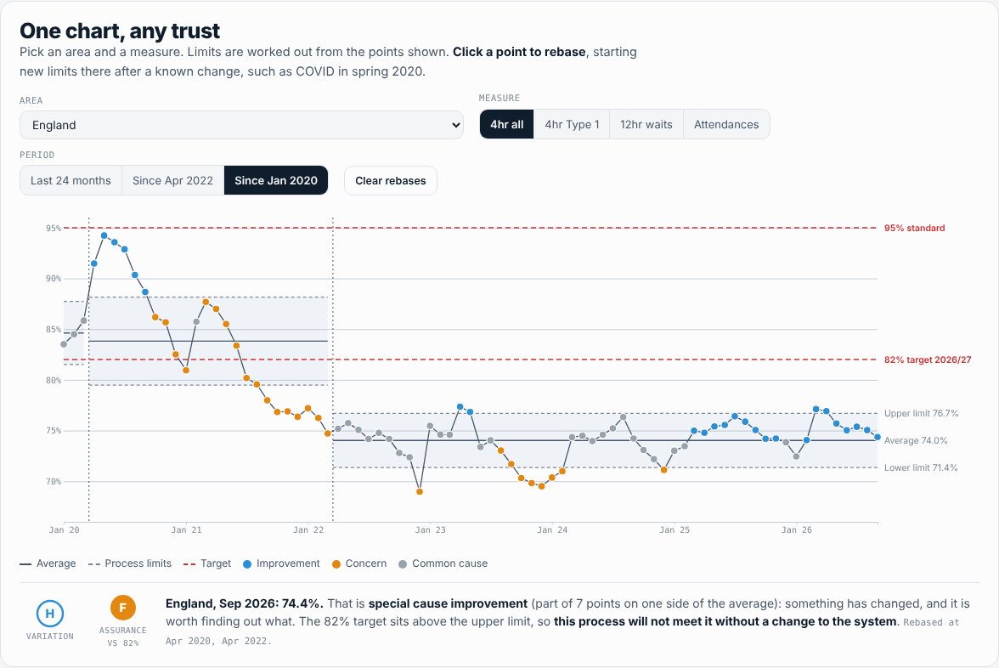
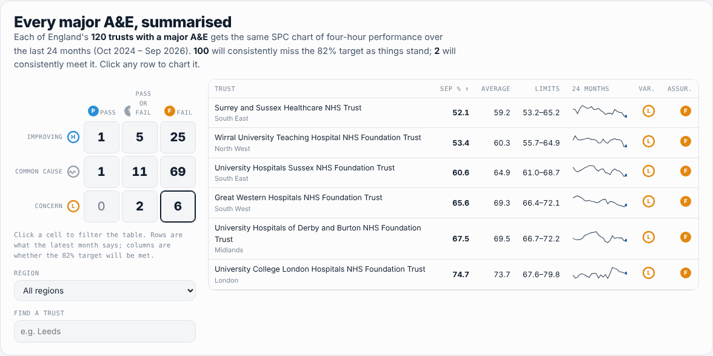

# A&E, read with SPC

**Four-hour A&E performance for every major emergency department in England, January 2020 to September 2026, charted with statistical process control (SPC) the way NHS England's *Making Data Count* asks boards to read it. The 82 raw monthly files, the cleaned tables, the cleaning log and the SPC code are all in this repo, and the dashboard reads them live from here.**

Track: Health Data · Python, pandas, pytest, JavaScript, D3.js · [Live dashboard](https://qaisbello.github.io/health-data/ae-spc/)



## What it shows

| Question | Finding |
|---|---|
| Where is England now? | **74.4%** seen within four hours in September 2026. Over the last 24 months the process averages **74.6%**, with limits of **72.5–76.6%**. |
| Does the pipeline match published figures? | 2025-26 recomputed from provider files: **74.9%**. The National Audit Office reports 74.9%. |
| Will the 82% target for 2026/27 be met? | Not without a change to the system. 82% sits **above England's upper limit**. **100 of 120** trusts with a major A&E have the same "consistently fail" assurance; **2** will consistently pass. |
| Who is above 82% today? | **7 of 120** major A&Es in September 2026. |
| What about 12-hour waits? | Waits of 12+ hours from decision to admit: **619,000** in the last 12 months, **13% more** than the 12 months before. In January 2020 there were 2,847 in the month; in September 2026, 50,582. |
| Is anything improving? | **31** trusts show special cause improvement in their latest month, **8** special cause concern. The rest are common cause: month-to-month movement that is noise, not news. |



## Why SPC

A month-on-month RAG rating treats every wobble as news. An XmR chart asks two better questions:

- **Variation:** is this month different from what the process normally produces? If not, there is nothing to explain.
- **Assurance:** given the process as it runs, will the target be met? If the target sits outside the limits, the answer is "always" or "never" until the system changes. Inside the limits, it is chance.

`src/spc.py` implements the rules of the NHS-R Community's [NHSRplotthedots](https://github.com/nhs-r-community/NHSRplotthedots) package, the reference implementation of Making Data Count:

- **Limits:** mean ± 2.66 × the average moving range. Moving ranges ≥ 3.267 × the average are screened out first.
- **Special cause** (in priority order):
  1. A point outside the limits.
  2. 7 points rising or falling.
  3. 2 of 3 points between the near (2σ) and process limits, all on one side of the mean.
  4. 7 points on one side of the mean.
- **Rebasing:** new limits from a chosen point, e.g. COVID (April 2020) and recovery (April 2022).

The dashboard runs a JavaScript port of the same code, so you can rebase by clicking a point. A test runs both versions on every trust's series (268 charts) and checks that they agree point by point.

## Raw to clean

NHS England publishes one CSV a month, and the format drifts. `src/clean.py` reconciles them and writes every check to `data/clean/data_quality_log.csv`.

| Problem in `data/raw` | What `clean.py` does |
|---|---|
| Three column layouts: "Number of A&E attendances Type 1" (Jan–Mar 2020), "A&E attendances Type 1" (Apr–Jul 2020), then booked-appointment columns from August 2020 | Maps every name the source has used to one standard set; fails loudly on an unknown column |
| September 2024 file has 6 empty, unnamed columns | Drops them |
| February 2021 downloaded twice | Keeps one, by the period inside the file, not the file name |
| England TOTAL row mixed in with providers; Jan–Mar 2020 mark it only in the name column | Removes it, then checks providers sum to it exactly in every month (they do) |
| Jan–Mar 2020 use sub-regions ("Midlands (West Midlands)") | Maps to the seven NHS England regions |
| Trailing spaces in region names; names in capitals in most files | Trims; title-cases, keeping NHS and acronyms |
| Booked appointments not reported separately from January to July 2020 | Set to 0 for those months; totals are unaffected |

**Reconciliation:** recomputed 2025-26 performance is checked against the NAO's published 74.9% and logged as Matches or Investigate.

**Definitions:**

- Four-hour performance counts all A&E types, booked appointments included, as NHS England reports it.
- "Major A&E" means trusts with any Type 1 (consultant-led, 24-hour) activity.
- 12-hour waits are from decision to admit to admission (trolley waits), not 12 hours from arrival.

## Run it

```bash
pip install -r requirements.txt
python src/clean.py       # data/raw -> data/clean + data_quality_log.csv
python src/summary.py     # SPC for England, 7 regions and every major A&E -> spc_summary.csv, summary.json
python -m pytest -q       # 24 tests: SPC rules, Python vs JavaScript, cleaned data
python build.py           # web/template.html -> web/index.html
```

**Adding a month:** download the new month's CSV from [NHS England's A&E statistics page](https://www.england.nhs.uk/statistics/statistical-work-areas/ae-waiting-times-and-activity/) into `data/raw/` and rerun the three commands. The dashboard picks it up from GitHub on the next load.

## Repo layout

```
data/raw/       82 monthly CSVs, exactly as downloaded
data/clean/     ae_monthly.csv, england.csv, regions.csv, spc_summary.csv, summary.json, data_quality_log.csv
src/            clean.py · spc.py · summary.py
web/            template.html -> index.html (dashboard)
tests/          test_spc.py · test_spc_js.py · test_pipeline.py
```

## Source and licence

NHS England, *A&E Attendances and Emergency Admissions*, monthly provider-level data. Contains public sector information licensed under the [Open Government Licence v3.0](https://www.nationalarchives.gov.uk/doc/open-government-licence/version/3/). The 2025-26 comparison figure is from the National Audit Office.

---

Built by [Qais Adeniji-Bello](https://qaisbello.github.io) · [LinkedIn](https://www.linkedin.com/in/qais-adeniji-bello/)
